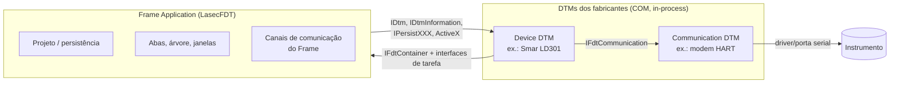

# 02 — Arquitetura FDT 1.x explicada

Referência: *FDT Interface Specification 1.2.1* (FDT-JIG, 2005). As seções citadas (§) são desse documento, salvo indicação.

## 1. A ideia central

Cada fabricante entrega, junto com o instrumento, um **DTM** (*Device Type Manager*): um componente de software Windows que conhece tudo sobre aquele tipo de equipamento — parâmetros, regras de validação, telas de configuração, diagnósticos. O **Frame Application** (PACTware, FieldCare, o futuro LasecFDT) é o "hospedeiro" genérico: não sabe nada de instrumentos específicos, apenas fala o protocolo FDT com qualquer DTM (§1.5, §2.1).



## 2. Tecnologia: COM

FDT 1.x é inteiramente baseado em **COM/ActiveX** (§1.4, §4.10.3):

- **Todas as interfaces são *dual*** (vtable + `IDispatch`). Isso permite DTMs em C++/ATL, Visual Basic 6 ou .NET.
- **Todos os dados de negócio trafegam como XML em `BSTR`** (`FdtXmlDocument`), validados por schemas XDR do MSXML (prefixo `x-schema:`). As interfaces COM são poucas e estáveis; a riqueza está nos documentos XML (§2.6).
- **Um objeto, várias interfaces**: todas as interfaces de um DTM estão no mesmo objeto COM, e todas as do Frame também; quem usa descobre as opcionais por `QueryInterface` (§4.2.1).
- **Retorno FDT ≠ HRESULT**: falha funcional é `VARIANT_BOOL FALSE` no `[out, retval]`; HRESULT de erro só para falhas COM (§4.10.2).
- **Versão**: a type library `Fdt100` mapeia FDT 1.2.1.0 para versão COM `1.20100` (§3.4). Confirmado lendo a `FDT100.dll`.

## 3. Os objetos (§2.4, §2.10, §4.2)

| Objeto | Quem implementa | Papel |
|---|---|---|
| **DTM (business object)** | Fabricante | Lógica e dados do instrumento; interface principal `IDtm`/`IDtm2` |
| **Presentation object** | Fabricante | Tela do DTM. Pode ser **controle ActiveX** embutido no Frame (`IDtmActiveXControl`) ou **aplicação própria** do DTM (`IDtmApplication`) |
| **FdtChannel** | DTM (ou Frame) | Canal de processo (valor de medição) e/ou **canal de comunicação** (`IFdtCommunication`) |
| **BTM** | Fabricante | Blocos de função (raro em HART) |
| **Frame Application** | Nós | Objeto com `IFdtContainer` + interfaces de tarefa; projeto, topologia, persistência, UI |

### Tipos de DTM (§2.10)

- **Device DTM** — instrumento de campo; *precisa* de um canal de comunicação de um pai para ir online.
- **Communication DTM** — interface PC↔barramento (modem HART, placa PROFIBUS); fornece canais `IFdtCommunication` e não precisa de pai.
- **Gateway DTM** — fornece canais e também precisa de um pai (ex.: remota PROFIBUS→HART).

## 4. Descoberta: categorias COM (Cap. 7)

DTMs não são encontrados por nome de arquivo: cada classe se registra em **categorias de componente COM** (§7.1.1–7.1.2). O Frame lista as classes de `CATID_FDT_DTM {036D1490-…}` com o *Component Categories Manager* (`ICatInformation::EnumClassesOfCategories`, §7.1.5) e, para detalhes (fabricante, tipos de equipamento suportados), **instancia** cada DTM e chama `IDtmInformation::GetInformation` (§7.1.6). A chave `HKLM\SOFTWARE\FDT\DTMCatalogUpdates\ModificationFlag` muda a cada instalação de DTM, permitindo atualizar o catálogo só quando necessário (§7.1.7).

## 5. Ciclo de vida e máquina de estados (§4.2.2)

O DTM tem estados bem definidos e **cada método só é válido em certos estados** (tabelas nas págs. 43–45). Resumo:

```mermaid
stateDiagram-v2
  [*] --> up: CoCreateInstance
  up --> new_created: IPersistXXX::InitNew
  up --> existing_created: IPersistXXX::Load
  new_created --> new_enabled: IDtm::Environment / IDtm2::Environment2
  existing_created --> running: Environment / Environment2
  new_enabled --> running: IDtm::InitNew(deviceType)
  running --> configured: IDtm::Config(userInfo)
  configured --> communication_set: IDtm::SetCommunication
  communication_set --> configured: ReleaseCommunication
  communication_set --> going_online: ConnectRequest
  going_online --> online: ConnectResponse ok
  online --> going_offline: DisconnectRequest
  going_offline --> communication_set: DisconnectResponse ok
  configured --> destroyed: PrepareToDelete
  configured --> zombie: PrepareToRelease (+ OnPreparedToRelease)
  new_enabled --> zombie: PrepareToRelease
  zombie --> [*]: IUnknown::Release final
```

Pontos que derrubam implementações ingênuas:
- `IDtmInformation` **só** é válida a partir de *new enabled*, ou seja, **depois** de `Environment` — não dá para consultar um DTM recém-criado.
- A UI ActiveX (`IDtmActiveXInformation`) só a partir de *configured*: é preciso `InitNew(deviceType)` **e** `Config(userInfo)`.
- `PrepareToRelease` é **assíncrono**: o DTM confirma com `IDtmEvents::OnPreparedToRelease`. Liberar antes pode deixar threads/janelas do DTM órfãs.
- Se um método falha, **o estado não muda** (§4.2.2).

## 6. Persistência (§2.7, §6.14)

O Frame é dono do armazenamento; o DTM é dono do formato. O DTM implementa **`IPersistStreamInit` ou `IPersistPropertyBag`** (interfaces COM padrão da Microsoft — não existem interfaces FDT de persistência na type library) e o Frame **deve suportar as duas** (§2.7.1). O data set é opaco para o Frame. `IFdtContainer::SaveRequest` apenas *avisa* que há mudanças; quem decide salvar é o Frame (§6.14.1.2). Dados volumosos (logs, históricos) vão para diretórios fornecidos por `IFdtBulkData`.

## 7. Comunicação (§2.4.3, §4.5.3, Cap. 6.1–6.2)

O Device DTM nunca abre portas: recebe do Frame um ponteiro `IFdtCommunication` via `IDtm::SetCommunication` e faz `ConnectRequest`/`TransactionRequest`/`DisconnectRequest` **assíncronos** (respostas por `IFdtCommunicationEvents`, correlacionadas por `invokeId`). Quem fornece esse ponteiro é normalmente o **canal de um Communication DTM** (`IDtmChannel::GetChannels` → `IFdtChannel` que também implementa `IFdtCommunication`), montando uma cadeia aninhada até o hardware (§6.2). O conteúdo das mensagens é XML específico do protocolo (schemas HART, PROFIBUS…).

## 8. Sessão, usuário e fases (§2.8, §2.9)

O Frame informa ao DTM o papel do usuário (`observer`, `operator`, `maintenance`, `planningEngineer`) em `Config` e a fase operacional (`engineering`, `commissioning`, `runtime`, `service`, `notSupported`) em `GetFunctions`. O DTM adapta menus e direitos. Um DTM que vai alterar dados pede `LockDataSet`; o Frame concede ou nega (multiusuário).

## 9. Interoperabilidade de versões (Cap. 3)

- Frame 1.2.1 **deve** usar `IDtm2::Environment2` quando o DTM a suporta; caso contrário `IDtm::Environment` (§3.3). Todos os 24 DTMs testados aqui são FDT 1.2 e **não** implementam `IDtm2`.
- Componentes da mesma versão *major* são compatíveis; FDT 2.x (major 2) é outra tecnologia (.NET), com categoria/registro próprios — o Frame precisa de um segundo host para eles.
