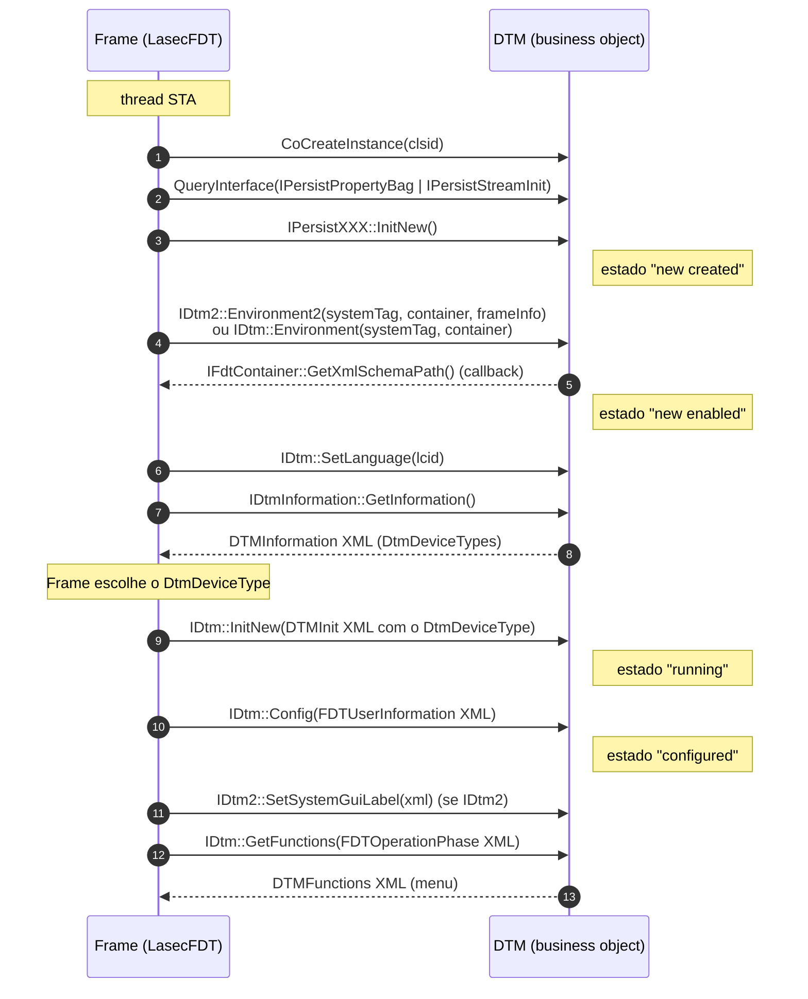
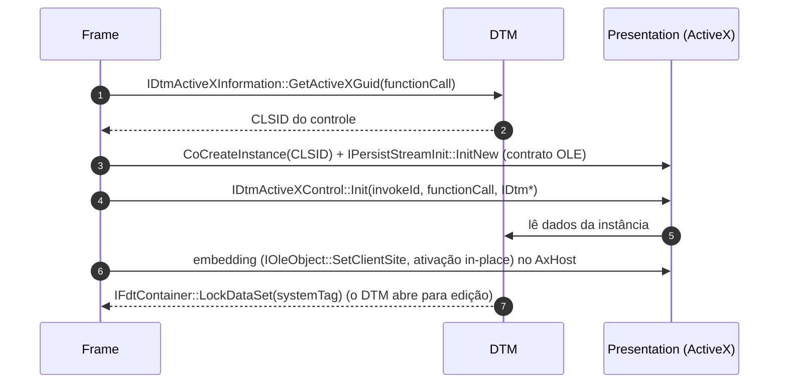
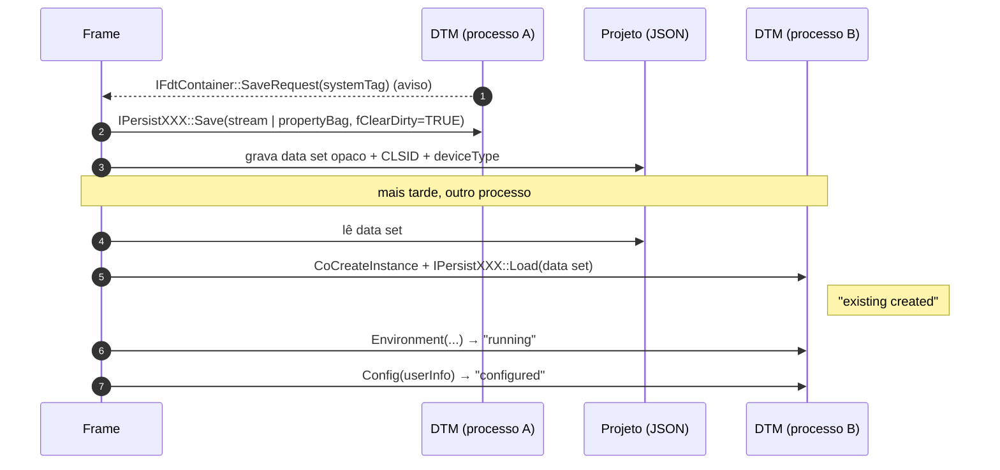
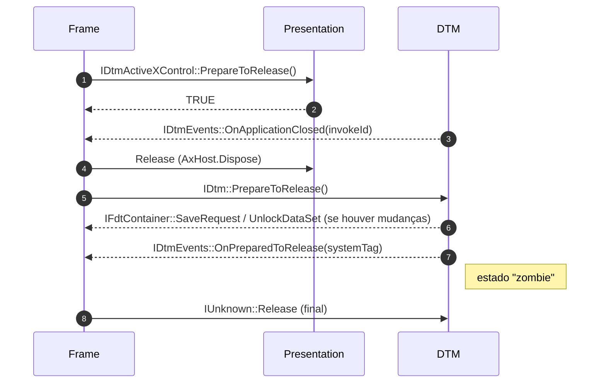

# 04 — Ciclo de vida de um DTM

Cada passo abaixo é uma chamada real documentada na especificação 1.2.1 e **executada pelo LasecFDT contra DTMs reais** (rastros completos em `docs/generated/probe/all/*.log`). Código: [DtmSession.cs](../src/LasecFDT.Fdt1/Frame/DtmSession.cs).

## 1. Localizar o DTM instalado (§7.1.2, §7.1.5)

1. Ler `HKCR\CLSID\{clsid}\Implemented Categories` nas **duas vistas** do registro (32 e 64 bits) e selecionar as classes com `CATID_FDT_DTM {036D1490-387B-11D4-86E1-00E0987270B9}` (ou `CATID_FDT_BTM {036D1690-…}`).
2. Conferir com `ICatInformation::EnumClassesOfCategories` (vê só a vista do processo atual — por isso a leitura direta é a principal).
3. Opcional: comparar `HKLM\SOFTWARE\FDT\DTMCatalogUpdates\ModificationFlag` com o valor guardado para saber se o catálogo mudou (§7.1.7).

## 2. Identificar o componente COM

De `HKCR\CLSID\{clsid}`: `InprocServer32` (caminho, `ThreadingModel`), `ProgID`, `TypeLib`. Se o servidor é `mscoree.dll`, o DTM é **.NET Framework** (valores `Assembly`, `Class`, `RuntimeVersion`, `CodeBase`). A arquitetura exigida do processo hospedeiro é a da vista do registro (vista 32 → processo x86). Implementado em [DtmDiscovery.cs](../src/LasecFDT.Fdt1/Discovery/DtmDiscovery.cs).

## 3–6. Criar, inicializar, ligar ao Frame e configurar (§6.13.1, §4.2.2)



Rastro real (Smar LD301, `lasecfdt probe SmarLD301DTM.DTMCore.1 --init`):

```
OK CoCreateInstance                      35 ms  Up
OK QueryInterface (inventário)                  IDtm, IDtmActiveXInformation, IDtmInformation, IDtmOnlineParameter, IDtmParameter, IFdtEvents, IPersistStreamInit
OK IPersistStreamInit::InitNew            0 ms  NewCreated
OK IDtm::Environment                    157 ms  NewEnabled   TRUE
OK IDtm::SetLanguage(0x0409)              0 ms  NewEnabled   TRUE
OK IDtmInformation::GetInformation       48 ms  NewEnabled   FDT 1.2; Smar LD301 DTM 3.03; 1 device type(s)
OK IDtm::InitNew                          6 ms  Running      TRUE
OK IDtm::Config                           7 ms  Configured   TRUE
OK IDtm::GetFunctions                     4 ms  Configured   1 função
OK IDtmActiveXInformation::GetActiveXGuid 12 ms Configured   7861A0B7-2F89-4B58-8E36-7CAF4A633321
OK IPersistStreamInit::Save               7 ms  Configured   7844 bytes
```

## 7. Abrir a interface gráfica (§6.13.3)



O diagrama da spec mostra "instanciação e embedding" antes de `Init`. Testamos três ordens (doc 08); a padrão do LasecFDT é **`Init` antes da ativação in-place**, porque funciona nos DTMs que funcionam em qualquer ordem e transforma em erro tratável uma falha que, na ordem inversa, derruba o processo (família `Smar.*DTM.1`).

## 8. Ler e modificar parâmetros

- Pela UI do DTM (caminho validado): o usuário edita; o DTM notifica `OnParameterChanged`, `SaveRequest`.
- Pelo Frame, sem UI: `IDtmParameter::GetParameters("FDT")`/`SetParameters` (§4.3.13; o XPath em 1.2/1.2.1 é sempre a raiz `"FDT"`, §8.2) e `IDtmSingleInstanceDataAccess` (§4.3.19). Planejado.
- Online: `IDtmOnlineParameter::UploadRequest/DownloadRequest` exigem estado *online* e um canal de comunicação. Fora do escopo desta fase (sem acesso a instrumentos).

## 9–10. Salvar e restaurar (§6.14.2, §6.13.2)



Observação: para uma instância existente **não** se chama `IDtm::InitNew` — o tipo de equipamento já está no data set (Figura 4: *existing created* → *running*).

## 11–12. Encerrar a sessão e liberar recursos (§6.13.4, §4.3.1.7)



Rastro real do fechamento da UI do LD301 (`docs/generated/ui/SmarLD301DTM.DTMCore.1.json`): `OnApplicationClosed` → `SaveRequest` → `UnlockDataSet` → `IDtm::PrepareToRelease` → `OnPreparedToRelease` (23 ms) → `Release` com 0 referências RCW restantes.

## 13. Regras práticas aprendidas com DTMs reais

| Regra | Origem |
|---|---|
| Criar e chamar o DTM sempre na mesma thread **STA** com bombeamento de mensagens | `ThreadingModel=Apartment` em todos os DTMs; eventos chegam via fila de mensagens |
| Esperar `OnPreparedToRelease` bombeando mensagens antes do `Release` final | §4.3.1.7; o LD301 envia o evento depois de 14–280 ms |
| **Uma instância de DTM por processo** (processo descartável) | DF100 trava ao recriar após liberar; DF116 trava ao liberar a 2ª instância (doc 08) |
| Rastrear cada chamada **antes** de executá-la | Um DTM pode derrubar o processo antes de qualquer relatório |
| Não interpretar `TypeLib` do DTM como prova de interfaces | Os DTMs Smar declaram só `IDTMCore` na type library, mas respondem a 7 interfaces FDT por `QueryInterface` |
