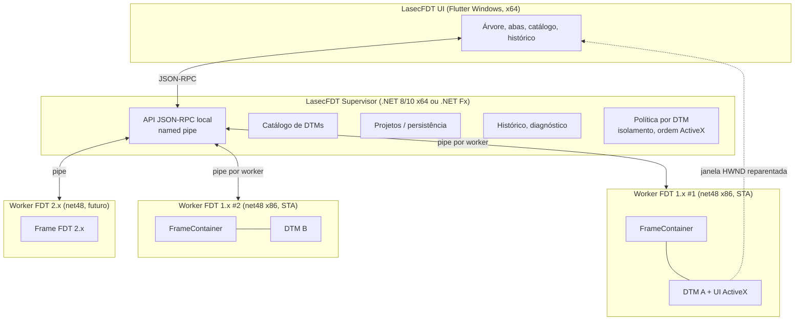
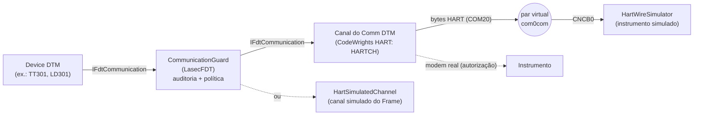

# 06 — Arquitetura do LasecFDT

## 1. Restrições impostas pelos DTMs reais (medidas nesta máquina)

| Fato | Evidência | Consequência |
|---|---|---|
| Os 25 DTMs instalados são servidores COM **in-process de 32 bits** (vista 32 do registro, PE x86) | `docs/generated/dtm-catalog.json` | O processo que hospeda DTMs **tem de ser x86** |
| Todos declaram `ThreadingModel=Apartment` | idem | Chamadas numa **thread STA** com laço de mensagens |
| Há DTM escrito em **.NET Framework 4** (`LasecHartCommDTM`, do próprio usuário; `InprocServer32=mscoree.dll`, `RuntimeVersion=v4.0.30319`; hospedado e validado, doc 08 §11) | registro | O host precisa carregar o **CLR v4 in-process**: um processo .NET 5+ não consegue ativar esse DTM |
| UIs são **controles ActiveX** (C++/ATL e VB6) | 23 de 24 DTMs devolvem CLSID de controle | Container OLE/ActiveX (WinForms `AxHost` resolve) |
| DTMs **derrubam o processo** (`0xC0000005`) em cenários válidos: DF100 ao recriar após liberar, DF116 ao liberar a 2ª instância; DLLs legadas na própria descarga | docs 08 | **Isolamento por processo** é requisito, não otimização |
| Controles **ATL 3.0/VB6** (família `Smar.*DTM.1`, DF100, DF116) executam thunks de janela no heap | doc 08 §5 (`0xC0000005` com acesso de **execução**) | Host **sem NXCOMPAT**, DEP religado com emulação de thunks ATL (§3) |

## 2. Decisão: C#/.NET Framework 4.8 x86 para o motor FDT 1.x

| Alternativa | Avaliação |
|---|---|
| **C# .NET Framework 4.8, x86** (escolhida) | COM interop maduro; usa o **interop oficial `Jigfdt.fdt100.dll`**; hospeda DTMs nativos, VB6 **e** .NET Framework; `AxHost` para ActiveX; mesmo runtime que o FDT 2.x usa (FDT 2.x é .NET Framework) |
| C# .NET 8/10 x86 | COM e WinForms funcionam, mas **não carrega DTMs .NET Framework** in-process (CLR v4 não coexiste com CoreCLR). Eliminado pelo DTM `LasecHartCommDTM` |
| C++ nativo (ATL) | Controle total, mas mais código para XML, persistência, testes; não hospeda DTMs FDT 2.x (.NET) |
| Flutter/Dart direto via FFI | Dart não tem STA/ActiveX/IDispatch de forma prática; e um DTM que trave derrubaria a UI |

## 3. Arquitetura

### Componentes

| Componente | Responsabilidade | Estado |
|---|---|---|
| `LasecFDT.Core` (netstandard2.0) | Modelos (catálogo, projeto, data sets), JSON, IDs FDT | Implementado |
| `LasecFDT.Fdt1` (net48 x86) | Descoberta, `FrameContainer`, `DtmSession` (máquina de estados), persistência, host ActiveX | Implementado |
| `LasecFDT.Cli` (`lasecfdt.exe`) | Ferramentas e harness: `typelib`, `discover`, `probe`, `probe-all`, `project` | Implementado |
| `LasecFDT.TestHost` | Aplicação mínima de testes (WinForms) | Implementado |
| **`LasecFDT.Worker.Fdt1`** (net48 x86, sem NXCOMPAT) | Processo que hospeda **uma instância de DTM**; JSON-RPC por named pipe (`WorkerMethods`); UI do DTM/canal em janela própria (dono opcional) | **Implementado e validado** |
| **`LasecFDT.Supervisor`** (netstandard2.0) | Cria/monitora workers, timeout por chamada (mata worker preso), detecta quedas, liga pai↔filho entre processos (OBJREF do canal), limpa servidores de porta órfãos | **Implementado e validado** |
| `LasecFDT.Core.Rpc` | Contratos e transporte JSON-RPC (uma mensagem por linha; fila de escrita dedicada) — reutilizável pela UI Flutter | Implementado |
| **UI Flutter** | Interface moderna | Planejado, após o motor |

### Por que um processo por instância de DTM
1. Defeitos de DTMs não derrubam a aplicação (medido: 3 DTMs causam `0xC0000005`).
2. Resolve o caso DF100/DF116 (estado global corrompido ao recriar/liberar): no modelo processo-por-instância, **24/24** passaram (doc 08).
3. Permite misturar arquiteturas no futuro (worker x64 para DTMs 64 bits, worker FDT 2.x).
4. Custo medido: ~1 s por worker (início + DTM até *configured*). A comunicação aninhada entre workers usa proxy COM do canal (ver "Comunicação entre workers"). Uma política por DTM (`isolation: process|shared`) poderá agrupar DTMs bem-comportados.

### Hospedagem de controles ActiveX legados (medido, doc 08 §5)

Muitos DTMs em campo são VC6/ATL 3.0 e VB6. Estas regras tornaram 24 das 25 UIs utilizáveis:

| Regra | Motivo medido | Implementação |
|---|---|---|
| Executável **sem `NXCOMPAT`** + `SetProcessDEPPolicy(PROCESS_DEP_ENABLE)` | ATL 3.0 executa "thunks" de janela no heap; com NXCOMPAT o Windows desliga a emulação de thunks ATL → `0xC0000005` (execução bloqueada por DEP) ao ativar o controle | `Directory.Build.targets` (`LasecLegacyActiveXHost=true`) + `LegacyActiveXProcess`. DEP continua **ativo**, com a emulação que o Windows dá a executáveis legados |
| Ordem **ativar → `IDtmActiveXControl::Init`** (§6.13.3) | A casca ATL só cria o controle VB6 interno na ativação; `Init` antes → `_com_error E_POINTER` | `ActiveXInitOrder.EmbedThenInit` (padrão) |
| Encerrar o processo com `TerminateProcess` depois de liberar tudo | DLLs legadas falham na própria descarga (`ExitProcess`/`OleUninitialize` → `0xC0000005`; `TerminateProcess` → 0) | `LegacyActiveXProcess.TerminateNow` no fim do worker e do TestHost |
| `GetActiveXProgId` quando `GetActiveXGuid` vem vazio (§4.3.3.2) | A CodeWrights só informa o ProgID | `DtmActiveXHost` |
| Controle .NET (`InprocServer32 = mscoree.dll`) entra **direto** na janela, sem `AxHost` | Neste processo o CLR entrega o próprio `UserControl`, não um RCW; ao liberar, o `AxHost` chama `ReleaseComObject` nele → `ArgumentException` | `DtmActiveXHost.OpenManaged` |

### DTMs escritos em .NET Framework (medido com o LasecHartCommDTM, doc 08 §11)

Um DTM .NET registrado como servidor COM in-process chega ao worker (também .NET) como **o próprio objeto gerenciado**: o CLR desembrulha o CCW e não há proxy COM no meio. Consequências e regras:

| Situação | Regra |
|---|---|
| Interfaces FDT | O DTM deve referenciar o mesmo interop oficial (`Jigfdt.fdt100`, assinado): o tipo .NET é o mesmo dos dois lados e o cast funciona |
| Interfaces OLE de persistência (`IPersistPropertyBag`/`IPersistStreamInit`/`IPropertyBag`) | Cada lado declara a sua (mesmo GUID, tipo .NET diferente) e o cast falha. `[TypeIdentifier]` não resolveu (o cast continua falhando e quebra a compilação de quem referencia o assembly, CS1748). O Frame chama pela **vtable do CCW** (`PersistCalls`), que é a mesma ABI de um Frame nativo; o DTM recebe o property bag como ponteiro e também o chama pela vtable |
| Liberação | `Marshal.FinalReleaseComObject` só em RCW (`Marshal.IsComObject`); o objeto gerenciado fica com o GC |

### Regras de threading e E/S do worker

- Uma thread STA (laço de mensagens WinForms) executa **todas** as chamadas ao DTM, uma requisição por vez (fila). As esperas do protocolo bombeiam mensagens; sem a fila, uma requisição executaria aninhada dentro de outra.
- A STA **nunca** faz E/S de pipe: `JsonLineChannel.Write` só enfileira; uma thread escritora envia. Medido: escrever na STA bloqueava, o DTM reentrava com outro evento durante o bloqueio e o processo travava (deadlock na mesma thread).
- Objetos do Frame expostos a COM herdam `StandardOleMarshalObject` (chamadas vindas de threads de trabalho dos DTMs são encaminhadas à STA).
- Cão de guarda: requisição com mais de 10 s grava a pilha da STA no log do worker (diagnóstico de DTMs que travam). O supervisor mata o worker se a chamada exceder o timeout.

### Comunicação entre workers

O canal do Comm DTM é passado ao worker do Device DTM como **referência COM** (`CoMarshalInterface`/`CoUnmarshalInterface`, MSHCTX_LOCAL): as interfaces FDT estão registradas com o marshaler universal (PSOAInterface, type library `FDT100.dll`), então o filho recebe um proxy COM real e os callbacks `IFdtCommunicationEvents(2)` voltam pelo mesmo mecanismo. O guarda de comunicação fica no worker do filho, envolvendo o proxy. Se o worker do pai cair, o supervisor marca a ligação como quebrada, pede ao filho `ReleaseCommunication` e encerra o servidor de porta que surgiu durante as operações do pai.

## 4. Integração com o Flutter

- **Transporte**: JSON-RPC 2.0 sobre *named pipe* local (`\\.\pipe\LasecFDT-<sessão>`), com ACL do usuário atual. Sem porta TCP aberta. Dart acessa pipes via `dart:io`/FFI simples.
- **Eventos**: notificações JSON-RPC (`dtm.event`, `dtm.state`, `dtm.progress`) — mapeamento direto de `FrameEvent`.
- **UI dos DTMs**: os controles ActiveX vivem no worker (thread STA). Duas opções:
  1. **Janela do worker reparentada** (`SetParent` do HWND do host ActiveX para dentro de um *placeholder* nativo do Flutter, sincronizando posição/tamanho). Experiência integrada; exige cuidado com foco/DPI.
  2. **Janela flutuante do worker** com dono (`owner`) na janela Flutter. Mais simples; recomendada para a 1ª versão.
- **Por que não FFI direto**: COM STA + ActiveX exigem laço de mensagens Win32 e isolamento de falhas; um DTM com violação de acesso dentro do processo Flutter fecharia a aplicação.

## 5. Comunicação aninhada (implementada — Fase 2)

Sequência implementada (§6.2.1.1, §6.2.2, §4.3.1.8/9/11), em `FrameContainer.ConnectToChannel` / `Disconnect`:

1. Comm DTM (raiz da cadeia) até *configured* → `IDtm::SetCommunication(NULL)` → *communication set*.
2. `IDtmChannel::GetChannels` → canal com `IFdtCommunication` (canal gateway).
3. Topologia interna + `IFdtChannelSubTopology::ValidateAddChild` → `OnAddChild`. `IFdtTopology::GetParentNodes/GetChildNodes` passam a refletir as ligações (DTMSystemTagListSchema).
4. Device DTM: `IDtm::SetCommunication(guarda)` → *communication set*. O DTM conecta (`ConnectRequest` → `OnConnectResponse(2)`) e troca `DataExchangeRequest/Response` (FDTHARTCommunicationSchema).
5. Desligar, na ordem inversa: `PrepareToReleaseCommunication` → `IDtmEvents::OnPreparedToReleaseCommunication` → `ReleaseCommunication` → `OnRemoveChild` no canal; só então os DTMs são liberados (filho antes do pai). `DtmSession.Release` faz isso automaticamente.

### Guarda de comunicação (segurança)

O Frame **nunca** entrega o canal real ao Device DTM: entrega um `CommunicationGuard`, que registra todo XML trocado e aplica a política:

| Política | Efeito | Uso |
|---|---|---|
| `Blocked` (padrão) | `ConnectRequest`/`TransactionRequest` retornam FALSE ("request refused", §4.5.3.2); nada chega ao canal | Trabalho offline com o DTM ligado à topologia |
| `ReadOnly` | Só comandos HART de leitura conhecidos (0, 1, 2, 3, 7, 8, 9, 11–16, 20, 21, 33, 48, 50, 54) passam; específicos do fabricante (≥128) e escritas são recusados | Diagnóstico seguro em instrumento real |
| `Full` | Tudo passa | Somente com autorização explícita do usuário, ou contra simulador |

`SetChannelParameters` vindo do DTM filho é sempre recusado. A lista de comandos de leitura vem do conjunto público de comandos HART (a especificação HART **não** está na documentação do projeto — conferir antes de uso em campo).

### Threading: `StandardOleMarshalObject`

Objetos .NET expostos a COM são, por padrão, **ágeis**: executam a chamada na thread de quem chamou. O LD301 chama `ConnectRequest` de uma thread de trabalho própria; com o guarda ágil, a resposta voltava para a thread errada e o processo travava (deadlock, medido). Por isso `FrameContainer`, `CommunicationGuard`, `CommunicationEventsRelay` e `HartSimulatedChannel` herdam de `StandardOleMarshalObject`: o COM encaminha toda chamada à thread STA dona do objeto, exatamente como num objeto COM nativo de apartamento.

### Simuladores (sem hardware)

- `HartSimulatedChannel`: canal FDT implementado pelo Frame; responde no nível XML (sem Comm DTM).
- `HartWireSimulator`: instrumento HART no nível de bytes (preâmbulos, delimitador, endereço curto/longo, comando, contagem, status, checksum XOR), numa porta serial; usado com o par virtual **com0com** `COM20 ↔ CNCB0` já instalado na máquina. Permite exercitar o **Comm DTM real** de ponta a ponta.
- `HartDevice`: camada de comandos comum (0, 1, 2, 3, 12, 13; demais → response code 64).
- `HartIpSimulator`: servidor HART-IP local (UDP e TCP, 127.0.0.1) que faz o papel de um gateway WirelessHART (comandos 74/84, sub-dispositivos por endereço longo, resposta atrasada código 33) ou de um instrumento HART-IP. Usado com o Comm DTM do usuário (`lasecfdt chain … --hartip-sim udp|tcp`).

### Entre processos (implementado)

Device DTM e Comm DTM em workers diferentes: o canal atravessa os processos como proxy COM (OBJREF), e o guarda fica no worker do Device DTM — ver §3 "Comunicação entre workers". Validado com CodeWrights (worker A) + TT301/LD301 (worker B).

## 6. FDT 2.x e 3.x

- FDT 2.x (IEC 62453-42) é **.NET Framework**, com interfaces e datatypes distribuídos pelo FDT Group (`Fdt.Interfaces`, `Fdt.Datatypes.*`). Um worker net48 separado servirá; o obstáculo é **licença/SDK**, não tecnologia (doc 09).
- FDT 3.x usa DTMs web/servidor; integração por um "FDT Server" — fora do escopo atual.
- `LasecFDT.Core` (netstandard2.0) é compartilhável por todos os hosts.

## 7. Segurança

- Workers sem privilégios de administrador; nunca escrevem em `HKLM`/registro de DTMs (a descoberta é somente leitura).
- O canal nunca é entregue diretamente ao DTM: sempre pelo `CommunicationGuard`, política `Blocked` por padrão; `Full` só com autorização explícita; confirmação antes de *download* para instrumento.
- Pipes restritos ao usuário; JSON validado; caminhos de projeto normalizados.
- Atualizações do catálogo disparadas por `DTMCatalogUpdates\ModificationFlag`.
