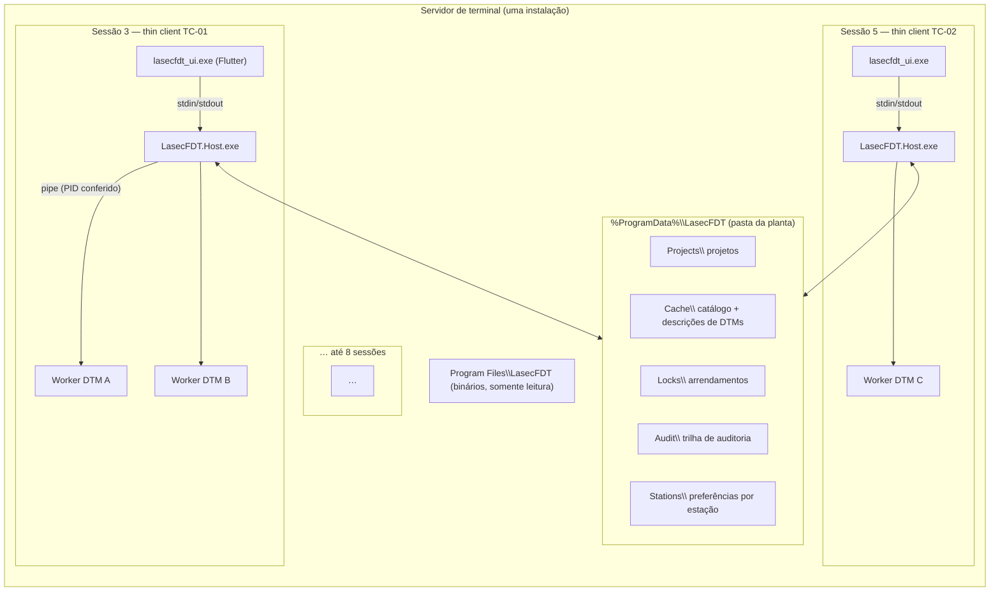

# 11 — Interface moderna e arquitetura para thin clients

Objetivo: um Frame FDT com as funções do PACTware, navegação moderna, temas claro e escuro no padrão visual do Gestor-UFU, rodando num **servidor de terminal** onde várias estações (thin clients) usam a mesma instalação ao mesmo tempo. Meta de projeto: 8 estações. O servidor deve reaproveitar o máximo possível sem misturar uma estação com outra.

## 1. Decisões

| Decisão | Motivo |
|---|---|
| **UI em Flutter (Windows x64)**, no padrão visual do Gestor-UFU: paleta roxo/ciano, cartões arredondados, escuro por padrão | Já prevista no doc 06; mesma identidade do Gestor-UFU. A UI nunca carrega DTMs: um DTM que trave ou caia não derruba a interface |
| **Um `LasecFDT.Host` por estação**, processo filho da UI, falando por stdin/stdout | O canal é anônimo e não tem nome: nenhuma outra sessão do servidor consegue abri-lo. O Host morre com a UI |
| **Um worker por instância de DTM** (já validado, doc 06/08) | Isolamento de falhas; obrigatório para DF100/DF116 |
| **Sem serviço central.** A coordenação entre estações usa arquivos de arrendamento numa pasta comum | Nada novo para instalar, monitorar ou derrubar. O Windows libera o arrendamento sozinho quando o processo termina, mesmo se cair |
| **Telas dos DTMs como janelas sem moldura**, cuja dona é a janela da UI, posicionadas sobre a área de conteúdo | `SetParent` entre processos acopla as filas de entrada: um DTM travado travaria a UI. Com janela dona e `SetWindowPos(SWP_ASYNCWINDOWPOS)` isso nunca acontece |
| **Fonte do sistema** (Segoe UI) em vez da Poppins via `google_fonts` | Nada é baixado da internet em tempo de execução, o que importa numa rede de planta |

## 2. Arquitetura num servidor de terminal

### O que é compartilhado e o que é isolado

| Recurso | Compartilhado entre estações | Isolado por estação |
|---|---|---|
| Binários (UI, Host, workers, DTMs instalados) | ✅ uma instalação; o Windows compartilha as páginas de código das DLLs e EXEs entre processos e sessões | — |
| Catálogo de DTMs e descrições (tipos de dispositivo) | ✅ calculado **uma vez por servidor** (`Cache\`) e lido pelas outras estações (medido: a 2ª estação lê do cache, `generatedBy` = 1ª estação) | — |
| Projetos | ✅ pasta comum; quem abre primeiro edita, os outros abrem **somente leitura** com o nome da estação que está editando | — |
| Portas seriais / modems | Arrendamento: uma porta usada por uma estação é **recusada** nas outras, com estação, usuário e horário | Porta redirecionada do thin client (RDP) tem chave da estação |
| Trilha de auditoria | ✅ `Audit\audit-AAAAMM.log`: estação, usuário, sessão e ação (incluindo conexões com escrita confirmadas) | — |
| Processos (UI, Host, workers), janelas, canais | — | ✅ sempre da sessão. Instância única por sessão (mutex `Local\`) |
| Preferências (tema, efeitos, idioma dos DTMs) | — | ✅ `Stations\<estação>\settings.json` (por estação, não por usuário) |
| Logs e temporários | — | ✅ `%TEMP%\LasecFDT\S<sessão>-<estação>\` |
| Eventos e tráfego de comunicação | — | ✅ só os da própria estação |

### Identidade da estação

Em planta é comum todas as estações entrarem com **a mesma conta genérica**. Por isso o isolamento nunca é feito por usuário:
- **Estação** = nome do thin client (`WTSClientName`). Na sessão de console, é o nome da máquina. `LASECFDT_STATION` força um nome, para testes ou quiosques.
- A mesma estação aberta em duas sessões (raro) recebe o sufixo `-S<sessão>`, e as duas nunca se misturam.
- **Sessão do Windows** = escopo dos processos, do mutex de instância única e dos temporários.

## 3. Coordenação entre estações (sem serviço)

Cada arrendamento é um arquivo em `Locks\` que o Host mantém **aberto** com compartilhamento só de leitura e `DeleteOnClose`:
- Outra estação que tente o mesmo recurso recebe violação de compartilhamento. Ela lê o conteúdo do arquivo (estação, usuário, sessão, horário) e mostra "em uso por …".
- Quando o Host termina, inclusive por queda, o Windows fecha o arquivo e o apaga: nada fica preso. Arquivo sem dono, por exemplo depois de uma queda de energia do servidor, é detectado e apagado.

| Chave | Quando é tomada |
|---|---|
| `station:<id>` | Enquanto a UI da estação está aberta (lista de estações ativas) |
| `project:<nome>` | Projeto aberto para edição |
| `port:<máquina>:COMn` / `port:<estação>:COMn` | Do primeiro ao último dispositivo conectado por aquela porta. A porta vem do data set do Comm DTM (`Port`; com `Interface` HART-IP não há porta local). Uma porta redirecionada por RDP (`\Device\RdpDr…`) é chaveada pela estação, porque cada thin client tem a sua COM3 |
| `catalog-scan`, `describe:<clsid>` | Enquanto uma estação recalcula o catálogo ou descreve um DTM: as outras esperam o resultado em vez de repetir o trabalho |

## 4. Economia de recursos (8 estações no mesmo servidor)

| Medida | Efeito |
|---|---|
| **Worker sob demanda.** Abrir um projeto não carrega nenhum DTM: cada nó só ganha processo quando é usado (tela, conexão, funções) | Projeto de 100 instrumentos aberto em 8 estações não vira 800 processos |
| **Descarregamento de ociosos.** Nó sem tela e sem conexão é descarregado depois de 10 min (`LASECFDT_IDLE_MINUTES`). O data set é salvo em memória antes e recarregado ao voltar a ser usado | A memória volta ao servidor sem perder alterações |
| **Teto por estação**: 16 DTMs carregados (`LASECFDT_MAX_WORKERS`), com mensagem clara ao operador | Uma estação não consome o servidor das outras |
| **Catálogo calculado uma vez por servidor** | Ler os 25 DTMs instancia cada um num worker descartável. Isso acontece uma vez, e não 8 |
| **Runtime único**: Host e workers em .NET Framework 4.8 x86 | As imagens nativas do framework são compartilhadas entre todos os processos e sessões |
| **Efeitos reduzidos**, automáticos em sessão remota: fundo liso, sem animações | Menos CPU no servidor (sem GPU, a renderização é por software) e menos banda RDP |
| Medido (memória privada) numa estação com 2 DTMs carregados, um deles online e a tela do LD301 aberta: UI 109 MB, Host 20 MB, workers 31 MB (LD301 com tela) e 17 MB (LasecHartCommDTM) | ≈ 180 MB por estação nesse uso, ≈ 1,4 GB para 8. Cada DTM a mais soma o seu worker (17–60 MB nos medidos) |

## 5. Encaixe das telas dos DTMs

1. A UI pede ao Host `node.openUi` com o HWND da própria janela.
2. O worker cria a tela ActiveX numa janela **sem moldura e fora da barra de tarefas** (`OpenUiParams.Embedded`), cuja dona é a janela da UI.
3. O Dart mede a área de conteúdo a cada mudança de layout e a envia ao runner nativo (`lasecfdt/native`, método `dock`).
4. O runner converte para pixels físicos (DPI da view) e chama `SetWindowPos(…, SWP_ASYNCWINDOWPOS | SWP_NOACTIVATE)`. Ao mover ou maximizar a janela, o runner reposiciona todas as telas.
5. Diálogos e menus do Flutter são desenhados na própria janela, por baixo das telas dos DTMs. Enquanto há um aberto (`PopupRoute`), as telas são escondidas e voltam ao fechar.
6. Abas: cada tela fica viva no seu worker. Trocar de aba só mostra uma janela e esconde as outras.

Validado com a tela de configuração do LasecHartCommDTM (.NET) e com a tela ActiveX do Smar LD301, cada uma no seu processo, lado a lado em abas.

## 6. API do Host (`LasecFDT.Core.Rpc.HostMethods`)

JSON, uma mensagem por linha (mesmo transporte do worker). Notificações do Host: `event` (eventos do Frame, da comunicação, das telas, dos workers e da planta) e `nodeChanged`.

| Área | Métodos |
|---|---|
| Estação e planta | `host.hello`, `station.settings`, `plant.leases`, `plant.stations` |
| Catálogo | `catalog.list` (com `refresh`), `catalog.describe` |
| Projeto | `project.list`, `project.new`, `project.open`, `project.save` (com nome = salvar como), `project.close`, `project.current` |
| Nós | `node.add`, `node.remove` (com a subárvore), `node.rename`, `node.functions` (DTM e canais), `node.openUi`, `node.closeUi`, `node.connect`, `node.disconnect`, `node.commLog`, `node.unload` |
| Busca e parâmetros | `node.scan`, `node.parameters`, `node.setAddress`, `node.compare`, `node.upload`, `node.revert`, `node.download` |

Regras que o Host garante, independentemente da UI:
- A política `Full`, que permite escrita no instrumento, exige `confirmFull`. Sem ela, a conexão é recusada. Com ela, a confirmação vai para a auditoria.
- Projeto somente leitura recusa toda edição.
- Ao fechar, a desconexão e a liberação seguem a ordem do protocolo (filhos antes dos pais) para todos os DTMs.

## 7. Funções do PACTware: situação

| Função | Situação |
|---|---|
| Projeto: novo, abrir, salvar, salvar como, fechar; lista de projetos da planta | ✅ |
| Topologia PC → Comm DTM → dispositivo; adicionar, remover (com subárvore), renomear | ✅ |
| Gateway aninhado (Comm → Gateway → dispositivo) | 🟡 implementado (conexão recursiva pelo caminho acima); sem DTM de gateway instalado para validar |
| Catálogo de dispositivos: busca, filtro por papel e fabricante, tipos de dispositivo, "Atualizar catálogo" | ✅ |
| Telas dos DTMs (todas as funções publicadas, inclusive de canal) encaixadas em abas | ✅ |
| Configurar o Comm DTM pela tela dele (porta, modem, HART-IP) | ✅ (validado: COM20 escolhida na tela do LasecHartCommDTM e usada na conexão) |
| Conectar/desconectar com política (somente leitura, completo com confirmação, bloqueado) | ✅ |
| Janela de mensagens/eventos com filtros | ✅ |
| Tráfego de comunicação auditado por instrumento | ✅ |
| Temas claro/escuro por estação | ✅ |
| Busca de instrumentos na rede (*topology scan*) com atribuição automática de DTM | ✅ §10 |
| Parâmetros pelo Frame: ver, comparar projeto × instrumento, ler do instrumento (com restaurar), gravar no instrumento | ✅ §11 (sucesso completo da leitura/gravação depende dos comandos do fabricante — ver §11) |
| Impressão/relatório do instrumento | ⬜ (Fase 3: documentação do DTM em XML+XSL) |
| Níveis de usuário (operador, manutenção, engenheiro, administrador) | ⬜ hoje o nível é sempre "manutenção" |
| Diálogos e telas extras pedidos pelo DTM | ⬜ (doc 09: o worker já emite o evento) |
| Importar projetos do PACTware | ⛔ formato proprietário, não documentado |

## 8. Instalação e implantação no servidor

**Instalador:** `LasecFDT-<versão>.msi`, publicado nos Releases do GitHub pelo workflow `.github/workflows/release.yml` (Actions → "Release LasecFDT" → versão). Localmente: `tools\release\build-release.ps1 -Version X.Y.Z -WixDir <WiX 3.14\bin>`.

| O MSI faz | Detalhe |
|---|---|
| Instala em `C:\Program Files (x86)\LasecFDT\` | A UI (`lasecfdt_ui.exe` e a pasta `data`, com o runtime VC++ ao lado) e o motor em `engine\` (Host, worker, `lasecfdt.exe`). Pacote de 32 bits, como o motor e os DTMs |
| Cria `C:\ProgramData\LasecFDT\` com escrita para o grupo **Usuários** | Pasta da planta (projetos, catálogo, arrendamentos, auditoria). É permanente: desinstalar não apaga projetos |
| Merge modules oficiais **redistribuíveis** da FDT 1.2.1 (§7.1.4) | `FDT_100`: `FDT100.dll` e type library, componente compartilhado com contagem de referência (não quebra o PACTware). `FDT_XMLSchemata`: `engine\FDT XML Schemas\` |
| Atalhos | Menu Iniciar e área de trabalho |
| Atualização | Uma versão nova substitui a anterior (MajorUpgrade) |

**Schemas do Frame:**
- A licença da FDT 1.2 (PNO) permite só uso interno, então os schemas de protocolo HART da 1.2 não vão no instalador.
- Na primeira execução, o motor monta `C:\ProgramData\LasecFDT\FDTSchemas-<hash>\` (`FdtSchemaLocator`). Ela combina os schemas 1.2.1 instalados com as subpastas de protocolo (§6.4) que outros Frames já instalaram na máquina, por exemplo o PACTware: HART `036D1498-…`, PROFIBUS e outros.
- Os arquivos dessas subpastas também são copiados para a **raiz** da pasta montada, porque é lá que os DTMs procuram `x-schema:FDTHARTCommunicationSchema.xml` e os demais (é assim que o PACTware os instala). O `v0.1.0` só os copiava para a subpasta; isso foi corrigido no `v0.1.1`.
- Validado a partir do MSI extraído: 41 schemas mais 13 subpastas de protocolo encontradas nesta máquina.
- **Os schemas HART são obrigatórios.** Em teste com o simulador, sem eles os DTMs dizem que conectaram mas não trocam dados: o comparar do TT301 não lê nada do instrumento, e, na cadeia CodeWrights → TT301, só passa o quadro inicial de identificação (comando 0): a tela do TT301 abre mas não lê nada (com os schemas: 6 quadros, comandos 0 e 13), e o desligamento falha. É uma falha silenciosa.
- **Pasta do operador:** `C:\ProgramData\LasecFDT\Schemas\` (`FdtSchemaLocator.PlantSchemaFolder`), criada pelo instalador com permissão de escrita para Usuários e um `LEIA-ME.txt`.
  - O operador coloca ali os schemas que obteve sob a licença dele, por exemplo a pasta `XML-Files` da *FDT Interface Specification* (FDT 1.2, PNO 2.162), baixada em <https://www.profibus.com/download/fdt-interface-specification>.
  - Aceita arquivos `.xml`/`.xsl` soltos, em subpastas ou dentro do `.zip` baixado. Tudo vai para a raiz da pasta montada.
  - Prioridade: schemas do merge module 1.2.1 > pasta do operador > outros Frames. Arquivo novo na pasta muda o hash e a pasta é montada de novo.
  - É permanente: a desinstalação não apaga o que o operador colocou.
- Sem PACTware e sem a pasta do operador, os schemas HART faltam. `LASECFDT_SCHEMA_PATH` (pasta completa) substitui tudo.
- **MSI de uso interno:** `tools\release\build-release.ps1 -Version X.Y.Z -InternalHart` gera `artifacts\LasecFDT-X.Y.Z-USO-INTERNO.msi`.
  - Ele inclui os 3 schemas HART da FDT 1.2 (`specs\FDT-1.2\XML-Files`) na raiz de `engine\FDT XML Schemas\`, sem alteração, junto com `engine\LEIA-ME-USO-INTERNO.txt`.
  - Gera também `LasecFDT-X.Y.Z-USO-INTERNO-portable.zip`. Sem o MSI não há o merge module de schemas, então o portátil leva a pasta completa `engine\FDTSchemas\` (FDT 1.2 com HART + 1.2.1 + anexo PROFIBUS, a mesma do desenvolvimento). Validado rodando o `engine\lasecfdt.exe` extraído, sem variável de ambiente: cadeia CodeWrights → TT301 com tela, 6 quadros HART, desligamento ok.
  - A licença da PNO concede esses arquivos *"solely for internal use by the User"* e proíbe repassá-los a terceiros. Por isso o script recusa rodar no GitHub Actions, e esses pacotes nunca devem ser publicados.
  - Validado: com a pasta montada só a partir desse MSI, sem PACTware, 53/53 testes passam.

**No servidor de terminal:**
1. Instale o MSI uma vez, como administrador. Instale também os DTMs dos instrumentos, como hoje.
2. **Portas:**
   - modems nos thin clients chegam por redirecionamento de porta COM do RDP, e cada estação tem a sua;
   - modems no próprio servidor são disputados pelo arrendamento;
   - gateways WirelessHART e HART-IP chegam pela rede.
3. Mantenha o padrão do RDS de pasta temporária por sessão.
4. Opcional: `ngen install` do Host, do worker e das DLLs do motor reduz a memória privada por processo.

## 9. Validação feita (nesta máquina)

| Cenário | Resultado |
|---|---|
| UI completa, pilotada por cliques reais: criar projeto, adicionar LasecHartCommDTM, configurar COM20 na tela dele, adicionar LD301, conectar somente leitura, abrir a tela do LD301, temas, salvar, fechar | ✅ tudo pela interface, com instrumento simulado em CNCB0 (com0com) |
| Fechar a UI com DTMs conectados e telas abertas | ✅ em 2 s: desconectado e liberado pelo protocolo, nenhum processo restante, arrendamentos apagados |
| Duas estações (TC-A/TC-B) na mesma planta, cada uma com o seu Host e os seus workers | ✅ projeto somente leitura na 2ª estação; porta recusada com o nome da 1ª; catálogo reaproveitado; depois que a 1ª fecha, a 2ª edita e conecta; auditoria com as duas (teste `HostTests.Two_stations_share_plant_without_mixing`) |
| Reabrir projeto | ✅ mesmo systemTag, nós sem processo até o uso, LD301 online de novo pelo data set salvo |
| Suíte `dotnet test` | ✅ 49/49 |

**Não validado ainda:** um servidor de terminal real com 8 sessões simultâneas e thin clients. As duas estações dos testes rodaram na mesma sessão, com `LASECFDT_STATION`. Também falta validar o redirecionamento de porta COM do RDP com um thin client real.

## 10. Busca de instrumentos (*topology scan*)

Botão **Buscar instrumentos** num Comm DTM ou gateway (`node.scan`):

1. **Catálogo com identidade.** O catálogo da planta ganha a identidade de cada tipo de dispositivo: atributos `manufacturerId` e `deviceTypeId` do `DtmDeviceType`, declarados pelo DTM.
   - Na primeira busca do servidor os DTMs ainda não descritos são lidos, um por worker descartável, com progresso na tela. Depois disso, o cache serve todas as estações.
   - O cache das descrições é versionado (`_v2`) porque as descrições antigas não tinham a identidade.
2. **Comunicação raiz.** O Comm DTM vira raiz da comunicação (`IDtm::SetCommunication(NULL)`), e a porta fica arrendada só durante a busca.
3. **Varredura.** `IFdtChannelSubTopology::ScanRequest` no canal com subtopologia. O resultado chega por `IDtmEvents::OnScanResponse` (DTMTopologyScanSchema), e o progresso por `OnProgress`.
4. **Associação de DTMs.** Cada instrumento (tag, endereço curto, endereço longo, fabricante, tipo) recebe os DTMs candidatos, nesta ordem:
   - **mesmo fabricante e tipo**;
   - **mesmo fabricante** (o nome do fabricante vem do DTM que declara o mesmo código);
   - **mesmo protocolo**.

   Instrumento cujo tag já é nome de um nó sob o canal aparece como "já no projeto".
5. **Adição ao projeto.** O operador confirma o DTM de cada instrumento e adiciona os selecionados, com o tag como nome.

Validado (teste `HostTests.Scan_finds_instrument_and_suggests_matching_dtm` e pela UI): o instrumento simulado (fabricante 62, tipo 2, tag TT-201) é encontrado pelo LasecHartCommDTM na porta virtual. O TT301 é sugerido como "mesmo fabricante e tipo", e o instrumento é adicionado e fica online. Uma segunda busca o marca como "já no projeto".

Limitações:
- Só os DTMs que declaram a identidade são associados com exatidão. Dos instalados, isso vale para a família `Smar.*DTM.1`; a família `*DTMCore` (LD301 e outros) não declara e entra como "mesmo fabricante".
- O endereço encontrado não é escrito no DTM do instrumento. O padrão é 0 (ponto a ponto); em *multidrop*, ajuste o endereço na tela do DTM.

## 11. Parâmetros comandados pelo LasecFDT

No painel do dispositivo, em **Parâmetros**:

| Ação | Interfaces FDT | Regras |
|---|---|---|
| **Ver parâmetros** | `IDtmParameter::GetParameters("/FDT")` (DTMParameterSchema), achatado em lista: variáveis `fdt:DtmVariable` e o endereço `BusInformation/SlaveAddress`. **Alterar…** no endereço: `node.setAddress` (`IDtmParameter::SetParameters`), só desconectado — é o endereço que o DTM usa para conectar (a busca já grava o endereço encontrado ao adicionar) | Offline; não comunica |
| **Comparar com o instrumento** | Projeto = `GetParameters` antes da leitura; instrumento = `IDtmOnlineParameter::UploadRequest("/FDT")` → `IDtmEvents::OnUploadFinished`, e depois `GetParameters`. Também o veredito do próprio DTM, `IDtmOnlineDiagnosis::Compare` (DTMOnlineCompareSchema), quando ele informa | O data set é salvo antes e **restaurado depois** (worker recarregado e reconectado com a mesma política). **Nada muda no projeto nem no instrumento** |
| **Ler do instrumento** | O mesmo upload, mas os valores lidos **ficam** no DTM | O projeto fica com alterações; **Restaurar o projeto** (`node.revert`) volta ao data set anterior |
| **Gravar no instrumento** | `IDtmOnlineParameter::DownloadRequest("/FDT")` → `IDtmEvents::OnDownloadFinished` | Exige conexão em **modo completo** (já confirmada ao conectar) **e** nova confirmação do operador. O Host confere as duas coisas e grava na auditoria |

Toda leitura e toda gravação mostram:
- o resultado informado pelo DTM e as mensagens `OnErrorMessage`;
- os comandos recusados pela política da conexão. Exemplo: em somente leitura, o TT301 pede o comando 162, do fabricante, e ele é recusado.

**Validado contra o instrumento simulado** (teste `HostTests.Parameters_compare_and_download_are_driven_by_the_frame` e pela UI, com o TT301):
- 78 parâmetros listados;
- a comparação mostra exatamente os 4 que diferem entre projeto e instrumento (tag, descritor, data e mensagem, lidos pelos comandos 12 e 13) e restaura o projeto;
- a gravação é recusada em somente leitura e sem confirmação;
- com modo completo e confirmação, o DTM escreve no instrumento (comando 18 recebido e guardado pelo simulador).

**O que não foi possível validar:** a leitura e a gravação *completas* com sucesso. Os DTMs da Smar usam comandos próprios do fabricante (TT301: 162; LD301: 128, 139, 157, 165, 179, 180, 183, 191, 203, entre outros), que o simulador não conhece. Por isso o DTM informa falha ("Upload failed!", "Download failed!"), e o LasecFDT mostra isso como está. Inventar respostas para comandos proprietários seria simular um comportamento que não conheço. A validação completa exige um instrumento real (doc 10), lendo primeiro, e só gravando com autorização.

## 12. Botão Parar e fechamento da janela

- **Problema encontrado:** as operações do projeto passam uma de cada vez por uma fila no Host.
  - Uma busca de instrumentos sem resposta leva cerca de 80 s.
  - Fechar o diálogo não a interrompia: ela seguia escondida e segurava a fila.
  - Ao fechar a janela, o Host esperava a busca terminar e a UI ficava 30 s sem resposta antes de forçar o fim.
- **Parar** (`operation.cancel`): botão vermelho na barra do projeto e no painel do nó sempre que há operação em andamento; no diálogo de busca, "Parar busca" (o "Fechar" também para).
  - O Host encerra na hora o processo do DTM ocupado. É a única forma garantida de soltar um DTM preso, e o isolamento por processo torna isso seguro: a porta e os servidores de comunicação são liberados.
  - As operações em andamento e as que estavam na fila terminam com o código `RpcException.Canceled`.
  - O nó volta a "offline" sem erro e carrega de novo no próximo uso, com o data set salvo antes da operação. Ler, comparar e gravar guardam o data set no projeto antes de falar com o instrumento.
  - Gravação interrompida é auditada e avisada: o instrumento pode ter ficado parcialmente gravado.
- **Fechar a janela (X):** a UI mostra "Encerrando…" na hora. O Host interrompe o que estiver em andamento (como o Parar), libera os DTMs ociosos pelo protocolo e encerra à força o que passar de 12 s.
- Validado: teste `Stop_interrupts_running_and_queued_operations_immediately_and_nothing_stays_locked` (busca real pela porta virtual + operação na fila, interrompidas em menos de 10 s; porta solta; o nó volta a funcionar). Pela UI: busca, X, janela fechada em poucos segundos.

## 13. Atualização automática pelo GitHub

Igual ao Gestor UFU: toda vez que o LasecFDT abre, a UI consulta o último Release em `LASEC-UFU/LasecFDT` (`ui/lasecfdt_app/lib/core/update_service.dart`). Se houver versão mais nova, pergunta se pode atualizar.
- **Onde vale:** só na instalação do MSI (`Arquivos de Programas (x86)\LasecFDT`). Cópia portátil e desenvolvimento não consultam. Sem internet ou com o GitHub fora do ar, nada acontece (limite de 10 a 15 s, em segundo plano).
- **Versão instalada:** a do motor (`host.hello`, igual à do MSI). Só oferece versão estritamente maior; ignora rascunhos, pré-releases e qualquer `.msi` com `USO-INTERNO` no nome.
- **Servidor com várias estações:** o botão "Atualizar" só libera quando nenhuma outra estação está com o LasecFDT aberto (arrendamentos `station:` da planta), porque o Windows Installer não troca arquivos em uso. O diálogo lista quem está aberto e tem "Verificar de novo". Também espera operação em andamento terminar.
- **Fluxo:** baixa o MSI em `%LOCALAPPDATA%\LasecFDT\Updates`, confere o SHA-256 informado pelo GitHub (`digest` do asset), salva o projeto se houver alteração, inicia um auxiliar PowerShell oculto e fecha como no X (o Host libera os DTMs). O auxiliar espera a UI, o motor e os workers desta sessão saírem (até 60 s), roda `msiexec /i … /passive` com elevação (UAC), confere a versão do `lasecfdt_ui.exe` instalado e reabre o programa. Cancelar o UAC mantém a versão atual e reabre. O MSI baixado (com o nome do arquivo do Release) **fica** em `Updates`: o Windows Installer registra essa origem e precisa dela para reparar ou rodar de novo o MSI da mesma versão (sem ela, erro 1316 "Erro na rede ao se tentar ler do arquivo", visto na v0.1.3). Só os MSIs de versões anteriores são apagados. Log: `%LOCALAPPDATA%\LasecFDT\atualizacao.log` (e `atualizacao.msi.log`).
- **Schemas preservados:** ao atualizar, o MSI copia os `*HART*.xml` de `engine\FDT XML Schemas\` da versão anterior para `%ProgramData%\LasecFDT\Schemas\` **antes** de removê-la (ação `PreserveHartSchemas`, imediata, logo antes de `RemoveExistingProducts`; condição `WIX_UPGRADE_DETECTED`). Nunca sobrescreve o que já está lá. Assim, passar de uma instalação de uso interno para o MSI público não perde os schemas HART, mesmo instalando o MSI à mão. A pasta do operador é permanente: nenhuma instalação ou desinstalação a apaga.
- **Teste:** `LASECFDT_UPDATE_TEST_VERSION=X.Y.Z` faz uma UI fora da instalação agir como a instalação padrão nessa versão (só para validar o fluxo).
- Validado nesta máquina: MSI 0.1.3 sobre o 0.1.1 de uso interno (schemas HART copiados para a pasta do operador; cadeia CodeWrights com instrumento simulado trocou 9 quadros e desconectou), e o diálogo de atualização em modo de teste.
